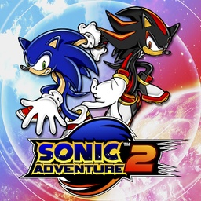

<h1 align=center>Sonic Adventure 2: Nintendo Switch port</h1>

<b>sa2-nx 1.0.8</b> · <a href="https://chanseyisthebest.github.io/sa2-nx-installer/">web installer</a> · <a href="https://github.com/ChanseyIsTheBest/sa2-nx/releases/tag/v1.0.8">release</a>

An unofficial native port of the Xbox 360 (Xbox Live Arcade) version of **Sonic Adventure 2** (2012), made by static
recompilation with [ReXGlue](https://github.com/rexglue/rexglue-sdk) and drawn natively with deko3d. No emulator.
Since 1.0.7 it is built on the ultimate base (renut_nx_ultimate_base) that the sibling ports share.

This repository contains no game files. You need your own copy of the game: its Xbox Live Arcade content package from
an Xbox 360 (`Content/0000000000000000/58411202/000D0000/525E7BB1E72A2DB99AB79281BA24938048198FAD58`); the **Battle**
DLC (`58411202/00000002/SonicAdventure2Battle`) is optional.

## Playing it on the Switch

1. Open the web installer: **https://chanseyisthebest.github.io/sa2-nx-installer/**
2. Give it the package file (`525E7BB1E72A2DB99AB79281BA24938048198FAD58`) or the whole `58411202` folder from your
   Xbox 360 (with the Battle DLC if you have it) and press **Create sa2-nx.zip**. It all runs in your browser: the
   movies are re-encoded to H.265 and the music to Opus, the other files are compressed, and everything goes into one
   file, `game_root.nxpack` (with its index `game_root.nxidx`): about 1.2 GB instead of 2.4 GB.
3. Extract `sa2-nx.zip` to the root of the SD card: it makes `sdmc:/switch/sa2-nx/`.
4. Start it with a game override (hold **R** while starting an installed title) or a forwarder.

To update from 1.0.7, replace `sa2.nro` in `sdmc:/switch/sa2-nx/` with the release's (or make a new zip); nothing else
changes. To update from 1.0.6 or earlier, make a new zip with the installer and extract it to the root of the SD card,
over your folder: since 1.0.7 the game needs its `deko3d_glsl.bin` and its game files. Your saves and `sa2.toml` stay.
A `game_root` folder left from an older install is not read any more and can be deleted.

Features:

- 60 FPS at the console's stock clocks in single player; the two-player race is heavier and can dip.
- Native Switch renderer (Renut's, on deko3d): 1280x720 handheld, 1920x1080 docked. Anti-aliasing (MSAA 2x, 4x, 8x)
  off by default, changed at once from the game menu.
- Game menu: hold **A + B + X + Y + L + R**. Every option of `sa2.toml`, the button maps of each player, the
  achievements; settings marked * apply at the next start, the others at once.
- The movies (H.265, hardware-decoded) and the music (Opus) from the installer's smaller files; the **BONUS VIDEO**
  interviews (after 5 hours of play) play.
- Relaxed vsync on by default (a missed frame shows at 50-59 FPS instead of 30); optional double buffering for less
  input lag.
- Two players: every controller is its own player; single Joy-Cons held sideways; **L + R + ZR** opens the
  controller screen.
- Face buttons by position as on the Xbox 360 pad (Switch B = Xbox A, A = B, Y = X, X = Y); by letter in the menu or
  `input_xbox_layout = false`.
- Control options from OpenSA2: stick fix and round deadzone (on by default), action buttons, camera invert and hold
  toggle (off by default).
- Language follows the Switch's (`language` in `sa2.toml`).
- Status Monitor shows the frame rate and resolution if SaltyNX is installed.

All options are in `sa2.toml` next to the NRO and in the game menu. Delete `sa2.toml` and the game writes the default
one again.

Warnings:

- Album applet mode does not give the game enough memory. A forwarder must be set to a **39-bit address space**.
- The first time you play after installing or updating it can stutter for a moment while shaders compile; later
  sessions start smoothly.
- The game runs per frame, so a lower frame rate also slows the game down.
- Made for stock clocks. A CPU overclock raises the frame rate in heavy scenes, at your own risk: an unstable memory
  overclock can corrupt the NAND or the SD card, so back up first. Guides:
  [How to get 60 FPS](https://rentry.org/howtoget60fps), [Mariko](https://rentry.co/mariko),
  [Erista](https://rentry.co/erista), [How to test stability](https://rentry.co/howtoteststability).

## Building

Windows, LLVM clang and the Visual Studio Build Tools for the PC build; devkitA64 and libnx from
[devkitPro](https://devkitpro.org) for the Switch; Python; and your own copy of the game for the code generator. Steps
in [docs/building.md](docs/building.md).

## Documentation

- [docs/sa2-ultimate-report.md](docs/sa2-ultimate-report.md): SA2 on the ultimate base, start here
- [docs/building.md](docs/building.md): building the PC test build, the NRO and the release
- [docs/ultimate-sync.md](docs/ultimate-sync.md): taking the base's later ports
- [docs/opus-h265.md](docs/opus-h265.md): the H.265 movies, the Opus music, the interviews and the installer
- [docs/1.0.6/](docs/1.0.6/): the documents of 1.0.6 and earlier (the porting guide, the renderers, every optimisation)

## Credits and license

- **SEGA and Sonic Team**: Sonic Adventure 2. This is an unofficial fan-made port with no affiliation.
- **ChanseyIsTheBest**: this port.
- **[Tom Clay](https://github.com/rexglue/rexglue-sdk)**: the ReXGlue SDK, built on the work of the
  **[Xenia](https://xenia.jp)** team.
- **[StevensND](https://github.com/StevensND/nfsmw-nx)**: nfsmw-nx (the SDK's Switch layer, the NVK build, much of the
  method) and [nfsmw-nx-installer](https://github.com/StevensND/nfsmw-nx-installer), which the first installer page was
  built on.
- **[nebadasSwifty](https://github.com/nebadasSwifty/masseffect-nx)**: masseffect-nx, the native renderer this port's
  grew from.
- **[hedge-dev](https://github.com/hedge-dev/XenosRecomp)**: XenosRecomp; shaders also go through DXC and SPIRV-Cross.
- **[kittycache](https://github.com/kittycache9/OpenSA2)**: OpenSA2, the control options (`app/src/sa2_controls.cpp`),
  with the SA2 Mod Loader code "Press B to Somersault" by Hyper and MainMemory.
- **[masterspike52](https://github.com/masterspike52/reNut)**: reNut, the Direct3D-level renderer, used with the
  author's permission as [banjo-nx](https://github.com/ChanseyIsTheBest) carries it;
  **[renderbag](https://github.com/renderbag/plume)**: plume; **[fincs](https://github.com/devkitPro/uam)**: uam.
- **[fincs](https://github.com/devkitPro/deko3d)**: deko3d.
- **[averne](https://github.com/averne)**: the NVDEC (nvtegra) backend of FFmpeg on the Switch, which decodes the H.265
  movies; **[libopus](https://opus-codec.org)**, **[LZ4](https://github.com/lz4/lz4)** and
  **[ZXC](https://github.com/hellobertrand/zxc)** for the installer's smaller files.
- **[devkitPro](https://devkitpro.org) and [switchbrew](https://github.com/switchbrew/libnx)**: devkitA64 and libnx.
- The sibling ports (Banjo-Kazooie: Nuts & Bolts, Sonic & All-Stars Racing Transformed, Mushihimesama Futari,
  Peggle 2, Culdcept Saga, Ridge Racer 6, Blur, Katamari), which share the ultimate base and its fixes: the installer
  page is culdcept-nx-installer's, with Ridge Racer 6's movie writer.
- The other libraries in [THIRD_PARTY_NOTICES.md](THIRD_PARTY_NOTICES.md).

No affiliation with SEGA, Microsoft or Nintendo. "Sonic Adventure 2" and "Sonic the Hedgehog" are trademarks of SEGA.
This repository contains no assets or code from the original game; everything made from your copy (`assets/`,
`app/generated/`, the shader package, the installer's files) is made on your own computer. Running homebrew needs custom
firmware, which violates Nintendo's ToS and can get a console banned.

GPL-3.0 (see [LICENSE](LICENSE)); the SDK keeps its BSD-3-Clause license (see
[THIRD_PARTY_NOTICES.md](THIRD_PARTY_NOTICES.md)).
