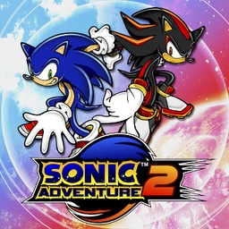

<div align=center>



</div>
<h1 align=center>Sonic Adventure 2 — Nintendo Switch port</h1>

A native Nintendo Switch port of the Xbox 360 (Xbox Live Arcade) version of **Sonic Adventure 2** (2012).

It's not an emulator. The PowerPC code of the game's `default.xex` and its stage-data module is statically recompiled
to C++ with [ReXGlue](https://github.com/rexglue/rexglue-sdk) and compiled for the Switch, and the game is drawn by a
native Vulkan renderer running on NVK (Mesa). It targets **60 FPS at the console's stock clocks**: the game runs per
frame, so a lower frame rate also slows the game down.

> [!NOTE]
> You need your own copy of the Xbox Live Arcade game: its content package from an Xbox 360
> (`Content/0000000000000000/58411202/000D0000/525E7BB1E72A2DB99AB79281BA24938048198FAD58`). The **Battle** DLC
> (`58411202/00000002/SonicAdventure2Battle`) is optional.

## How to install

1. Open the installer page: **https://chanseyisthebest.github.io/sa2-nx-installer/**
2. Choose your game: its **package file** (`525E7BB1E72A2DB99AB79281BA24938048198FAD58`) or the whole `58411202`
   folder copied from your Xbox 360, with the **Battle** DLC (`SonicAdventure2Battle`) if you have it. Then press
   **Create sa2-nx.zip**. Everything runs in your browser and the game files never leave your computer: the page
   checks your copy, downloads the build and makes the shaders and the game pack from your files.
3. Extract the downloaded `sa2-nx.zip` into `sdmc:/switch/`.

Your `sa2-nx` folder should look like this:

```text
/switch/sa2-nx/
  sa2.nro
  LICENSES.txt
  sa2.toml                  (your settings; written at the first start when it is missing)
  sa2_shaders.mesp          (the game's shaders, made from your copy)
  sa2_shaders.mesp.idx
  game_root.nxpack          (the files of your game, in one file)
  game_root.nxidx
  dlc/                      (optional: the Battle DLC package)
```

Launch it with a game override (hold **R** while starting an installed title) or a forwarder. Album applet mode does
not give the game enough memory. If you use a forwarder, set it to a **39-bit address space**.

To build everything yourself instead, see [docs/building.md](docs/building.md).

> [!NOTE]
> **Updating:** open the installer page again and press **Create sa2-nx-update.zip**. It only holds the new
> `sa2.nro` and the shaders, so there is no need to copy the game again: extract it over your folder. Your
> `sa2.toml`, the game files and the `cache` folder stay.

> [!CAUTION]
> **The first time you play** after installing or updating, the game compiles the graphics pipelines it has not seen
> yet, so **IT CAN STUTTER for a moment** in new places. They are saved in `cache/` on the SD card and later sessions
> start smoothly.

## Controls

By default the face buttons work **by position, as on the Xbox 360 pad** the game was made for: the bottom button
jumps (the Xbox's A), the right one is the Xbox's B, and so on.

<div align="center">

| Switch | Xbox 360 |
| --- | --- |
| B (bottom) | A |
| A (right) | B |
| Y (left) | X |
| X (top) | Y |
| ZR / ZL | RT / LT |
| R / L | RB / LB |
| + | Start |
| − | Back |
| Sticks / D-pad | Sticks / D-pad |

</div>

To use the buttons by letter instead (the Switch's A acts as A), set `input_xbox_layout = false` in `sa2.toml`.

**Two players:** every controller is its own player, in the order they connect. The console in handheld mode counts
as one, so handheld + a Pro Controller makes players 1 and 2. Single Joy-Cons are held sideways, one per player (SL
and SR are the triggers). **L + R + ZR** opens the system's controller screen to connect, reorder, or split a Joy-Con
pair.

**Remapping:** each player has a button map in `sa2.toml` (`[input_p1]` and `[input_p2]`).

## Settings

`sa2.toml`, next to the NRO, holds only your options. Everything else is built into the NRO.

<div align="center">

| Setting | What it does |
| --- | --- |
| `language` | `auto` follows the Switch's language; or `english`, `japanese`, `french`, `german`, `spanish`, `italian` |
| `sa2_msaa` | Anti-aliasing: `0` off (default), `2` or `4` (smoother edges, more GPU work) |
| `sa2_vsync_relaxed` | `true` (default): a frame that misses 60 FPS is shown as soon as it is ready (50-59 FPS) instead of falling to 30 |
| `input_xbox_layout` | Face buttons by position (`true`, default) or by letter (`false`) |
| `input_joycon_sideways` | Single Joy-Cons held sideways, one per player (`true`, default) |
| `[input_p1]`, `[input_p2]` | Each player's buttons: for every Xbox button, the Switch buttons that press it, e.g. `a = "B, ZR"` |

</div>

If you delete `sa2.toml`, the game writes the default one again at the next start.

## Resolution

The game draws **1280x720** in handheld mode and **1920x1080** docked, and switches when you dock or undock (a short
hitch while its render targets are made again). The image in handheld mode is exactly the Xbox 360's.

## Performance

The CPU is what limits it: the game runs on three cores at 1020 MHz. In single player it holds 60 FPS with barely any
dips. The two-player race is the heaviest part of the game: in version 1.0.0 it often ran around 50 FPS. With relaxed
vsync a missed frame costs a few FPS instead of halving the frame rate.

The released NRO is built with PGO from a console session, which made 1.0.0 about 15 % faster than the same build
without it. Version 1.0.1 is about 15 % faster again in play (an estimate, not a measurement): three rounds of work
on the translated code and the runtime, a new profile and a better link, all in
[docs/cpu-rounds.md](docs/cpu-rounds.md).

What was done to get there, round by round and with the measurements, is in
[docs/enhancements.md](docs/enhancements.md).

## Overclocking

The port is made to run at the console's stock clocks **with no overclock**. A CPU overclock raises the frame rate
in the heavy scenes.

> [!CAUTION]
> Overclocking pushes the console beyond what it was designed for and you do it at your own risk. An unstable memory
> overclock can corrupt the NAND or the SD card: make a backup first and test every change.

These community guides explain how to do it:

- **[How to get 60 FPS](https://rentry.org/howtoget60fps)**: the tools you need (Horizon OC, Ultrahand, Status
  Monitor...) and how to set them up.
- **[Mariko guide](https://rentry.co/mariko)**: overclocking the Switch V2, Lite and OLED.
- **[Erista guide](https://rentry.co/erista)**: overclocking the original 2017 Switch.
- **[How to test stability](https://rentry.co/howtoteststability)**: how to check that your clocks are stable.

Status Monitor shows the port's frame rate and resolution if SaltyNX is installed.

## How it works

- **The game's code is translated, not emulated.** [ReXGlue](https://github.com/rexglue/rexglue-sdk) translates every
  function of the game's program to C++, which is then compiled for the Switch. ReXGlue also gives the game what it
  expects from an Xbox 360: its system, files, audio and controllers. This port adds the Switch part: memory,
  threads, crash handling, clocks, audio output and showing the frames on screen.
- **Its own renderer.** Imitating the Xbox 360 GPU was far too slow on the Switch. The port draws the game's frames
  with Vulkan instead. The game's Direct3D draw, clear and state code is replaced by native code that hands the
  renderer its records directly. Every replacement was checked call by call against the original.
- **Shaders translated beforehand.** The game's GPU programs are translated with
  [XenosRecomp](https://github.com/hedge-dev/XenosRecomp) and DXC into one package. The vertex shaders Direct3D
  rebuilds at run time for each vertex layout are recognised from the package as they load.
- **Graphics driver.** Vulkan runs on NVK, from the Mesa project, through
  [mesa-switch](https://github.com/danfromtico/mesa-switch), in the build of
  [nfsmw-nx](https://github.com/StevensND/nfsmw-nx).
- **Optimization.**
  - The busiest game functions run as hand-written or translated native code. Each one is checked against the
    original while the game runs.
  - The code generator keeps registers in C++ locals and makes calls direct. The build uses LTO, PGO from a console
    session, and hot functions first in memory.
  - The renderer's CPU cost per draw is a fraction of what it was.
  - Every one of these has its own setting and was tested to give exactly the same picture, frame for frame.

## Documentation

For anyone porting another Xbox 360 game, or curious about how this one was done. **Start with
[docs/porting-guide.md](docs/porting-guide.md)**: how to port an Xbox 360 game to the Switch from scratch, with every
optimisation this port uses.

<div align="center">

| Document | What it explains |
| --- | --- |
| [docs/porting-guide.md](docs/porting-guide.md) | Porting an Xbox 360 game to the Switch, from the first translation to a 60 FPS build |
| [docs/building.md](docs/building.md) | How to build the PC test build, the NRO, the shader package and the SD folder |
| [docs/enhancements.md](docs/enhancements.md) | Every optimisation, why it is exact, how it was checked and its setting |
| [docs/cpu-rounds.md](docs/cpu-rounds.md) | The three CPU rounds and the link of version 1.0.1: what each change does, what was measured, what was dropped |
| [docs/api-renderer.md](docs/api-renderer.md) | Replacing the game's Direct3D with native code |
| [docs/direct-renderer.md](docs/direct-renderer.md) | Taking the GPU emulation out of the renderer, step by step |
| [docs/gpu-optimisation-candidates.md](docs/gpu-optimisation-candidates.md) | The GPU's cost on the Tegra X1 with NVK, and what was cut |
| [docs/switch-testing.md](docs/switch-testing.md) | Testing on the console, and what each build changed |
| [docs/sa2-notes.md](docs/sa2-notes.md) | Notes on the game's own code |

</div>

## Build

Windows, LLVM clang 20 and the VS 2022 Build Tools for the PC build; devkitA64 and libnx from
[devkitPro](https://devkitpro.org) and NVK built from [mesa-switch](https://github.com/danfromtico/mesa-switch) for the
Switch; Python; and your own copy of the game for the code generator. The whole process is in
[docs/building.md](docs/building.md).

<div align="center">

| Folder | Contents |
| --- | --- |
| `app/` | The game: hooks, native renderer, native functions, settings, CMake project |
| `sdk/` | ReXGlue SDK with the Horizon layer and the code generator changes |
| `shaders/` | XenosRecomp with this port's changes, and the shader package tools |
| `tools/` | Code generation steps, build and test scripts, analysis tools |
| `patches/` | Every change to third-party code (the SDK, FFmpeg, XenosRecomp) as diffs against upstream |
| `pgo/` | The PGO profile the released NRO was built with |
| `mesa/` | Which NVK driver build the NRO links (this port does not change the driver) |
| `docs/` | Documentation |

</div>

## Credits

- **SEGA and Sonic Team** — creators of Sonic Adventure 2. This is an unofficial, fan-made port with no affiliation.
- **ChanseyIsTheBest** — this port.
- **[Tom Clay](https://github.com/rexglue/rexglue-sdk)** — the ReXGlue SDK, built on the work of the
  **[Xenia](https://xenia.jp)** team.
- **[StevensND](https://github.com/StevensND/nfsmw-nx)** — nfsmw-nx: the Switch layer of the SDK, the NVK build and
  much of the method; and [nfsmw-nx-installer](https://github.com/StevensND/nfsmw-nx-installer), the installer page
  this port's is built on.
- **[nebadasSwifty](https://github.com/nebadasSwifty/masseffect-nx)** — masseffect-nx: the native renderer this port's
  renderer grew from.
- **[hedge-dev](https://github.com/hedge-dev/XenosRecomp)** — XenosRecomp, the Xenos shader translator.
- **[danfromtico](https://github.com/danfromtico/mesa-switch)** and **[NaGaa95](https://github.com/NaGaa95/mesa-switch)**
  — mesa-switch: Mesa, NVK and NAK on Horizon.
- **[devkitPro](https://devkitpro.org) and [switchbrew](https://github.com/switchbrew/libnx)** — devkitA64 and libnx.
- The sibling ports (Banjo-Kazooie: Nuts & Bolts, Sonic & All-Stars Racing Transformed, Mushihimesama Futari, Peggle
  2), which share their fixes with this one.
- The other libraries listed in [THIRD_PARTY_NOTICES.md](THIRD_PARTY_NOTICES.md).

## Legal

No affiliation with SEGA, Microsoft or Nintendo. "Sonic Adventure 2" and "Sonic the Hedgehog" are trademarks of SEGA.
This repository contains no assets or program code from the original game. Users must provide their own legally
obtained copy, and everything made from it (`assets/`, `app/generated/`, the shader package) is made on their own
computer. Running homebrew requires custom firmware, which violates Nintendo's ToS and can get a console banned —
your call.

Source code is provided under the GPL-3.0 License (see [LICENSE](LICENSE)), like the ports it builds on. The SDK keeps
its BSD-3-Clause license (see [THIRD_PARTY_NOTICES.md](THIRD_PARTY_NOTICES.md)).
